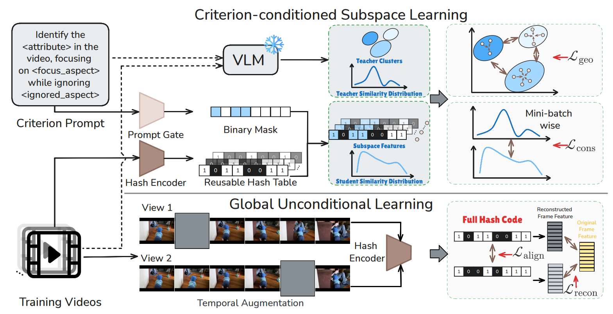

# PROBE: VLM-Guided Discrete Structural Reconfiguration for Customized and Efficient Video Retrieval

## 📌 1. Introduction

> **PROBE: VLM-Guided Discrete Structural Reconfiguration for Customized and Efficient Video Retrieval**. Yiyang Gu, Kaili Liu, Tao Zhe, Binqi Chen, Jiayue Fan, Junwei Yang, Zequn Liu, Zhiping Xiao, Chong Chen, Xiao Luo, Xian-Sheng Hua, Ming Zhang. *Proceedings of the 32nd ACM SIGKDD Conference on Knowledge Discovery and Data Mining (KDD 2026)*.



Existing self-supervised video hashing methods encode every video into a compact binary code under a single, fixed similarity geometry that enforces one notion of similarity across all queries — regardless of what a user actually cares about (action, scene, emotion, object, ...). **PROBE (Prompt-as-Operator for Binary-Indexed Retrieval)** removes this restriction while keeping the index reusable:

- Each video is still hashed **once** into a compact, reusable `K`-bit binary code — the index is never rebuilt or recomputed per query.
- A text **prompt** describing the retrieval *criterion* (e.g. "focus on the action", "focus on the emotion") is mapped to a sparse **binary gating mask** over the same `K` bits.
- Video–video similarity under that criterion is computed as a **masked Hamming distance**: the prompt does not touch the stored code, it only selects *which bits participate* in the comparison, giving criterion-dependent similarity geometry "for free" via bitwise operations.
- A frozen vision–language model supervises this process: prompt-conditioned VLM embeddings are clustered per dataset/criterion and used to (i) regularize the geometry inside each prompt-conditioned hash subspace (`L_geo`), (ii) preserve local neighborhood consistency between the VLM teacher and the student similarity distributions (`L_cons`). In parallel, a prompt-agnostic contrastive alignment + masked-frame reconstruction objective (`L_align`, `L_recon`) keeps the *full* hash space stable across views and datasets.

A single PROBE model, trained once on a mixture of heterogeneous video datasets, outperforms strong video-hashing baselines (BTH, DKPH, MCMSH, ConMH, BerVAE, S5VH) both on the criteria it was trained on and on unseen datasets / unseen criteria (e.g. ActivityNet, HVU-Concept, HVU-Object), without any dataset- or criterion-specific retraining.


## 📝 Citation

📄 [Paper (ACM DL)](https://doi.org/10.1145/3770855.3818016) · 💻 [Code](https://github.com/liamgu06/PROBE)

If you find PROBE useful in your research, please consider citing:

```bibtex
@inproceedings{gu2026probe,
  author    = {Gu, Yiyang and Liu, Kaili and Zhe, Tao and Chen, Binqi and
               Fan, Jiayue and Yang, Junwei and Liu, Zequn and Xiao, Zhiping and
               Chen, Chong and Luo, Xiao and Hua, Xian-Sheng and Zhang, Ming},
  title     = {{PROBE}: {VLM}-Guided Discrete Structural Reconfiguration for
               Customized and Efficient Video Retrieval},
  booktitle = {Proceedings of the 32nd ACM SIGKDD Conference on Knowledge
               Discovery and Data Mining},
  series    = {KDD '26},
  year      = {2026},
  publisher = {Association for Computing Machinery},
  doi       = {10.1145/3770855.3818016},
  url       = {https://doi.org/10.1145/3770855.3818016}
}
```
